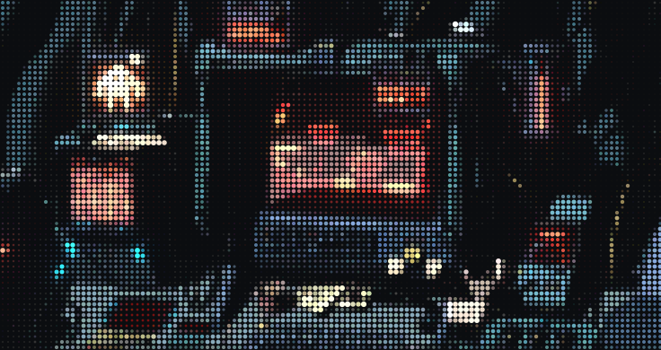

<p align="center"></p>

<p align="center"></p>

```sh
$ whoami
> arun — systems & backend engineer. mostly rust.

$ cat ~/.now
→ learning   : DL (and kind of LLMs)
→ writing    : blog @ ocdbyt.es/blogs
```

#### [More AI focused work | AIメインの仕事](https://github.com/ocdbytes-ai)

<sub>[blog](https://ocdbyt.es/blogs) · [x](https://x.com/ocdbytes) · [email](mailto:arunjangra1001@gmail.com)</sub>
